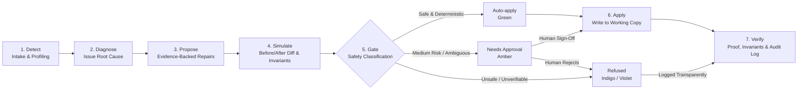
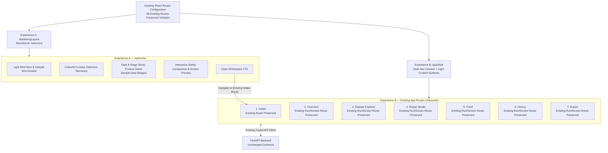
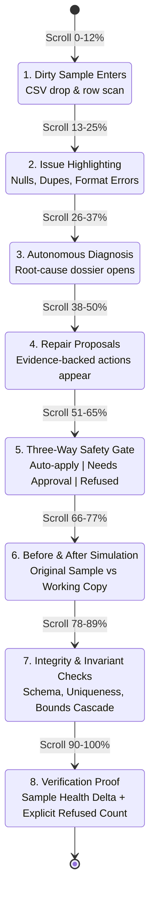
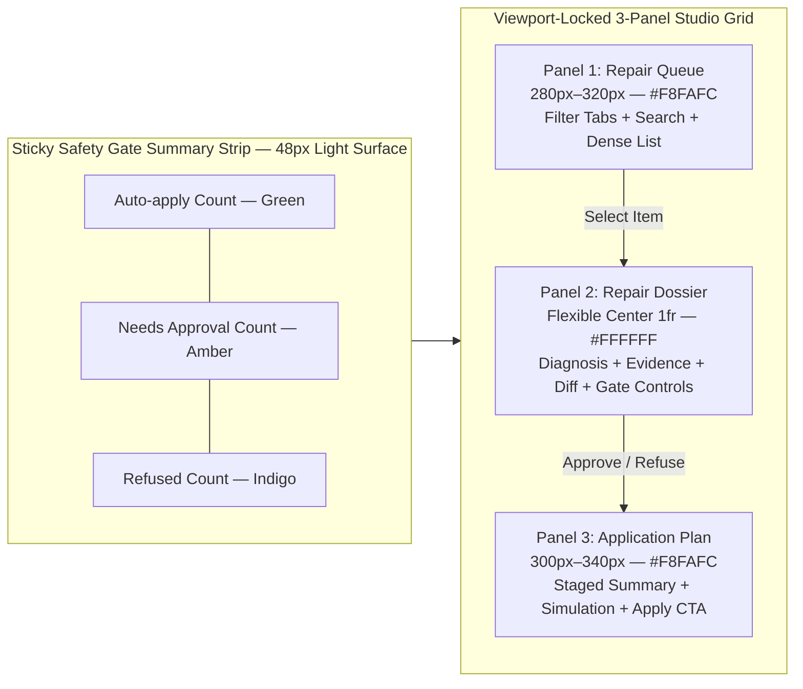

# DATAFIX — MASTER PRODUCT DESIGN AND FRONTEND ARCHITECTURE SPECIFICATION

**Document Version:** 1.1 (Final Implementation Specification)  
**Target Environment:** Google Antigravity Implementation Blueprint  
**Product:** DataFix — Autonomous Data Quality and Repair Engine  
**Frontend Stack:** React 19, TypeScript, Vite, Tailwind CSS v4, React Router  
**Backend Stack:** FastAPI (Existing API contracts preserved; zero backend redesign)  
**Team Context:** Two-person engineering team — Akash (Frontend, Integration, Architecture Coordination, Deployment) and Teammate 3 (Backend, Data Engineering)  
**Evidence Base:** Supplied research dossiers (`SODA_MOTION_AND_UI_RESEARCH.md`, `MONTECARLO_MOTION_AND_UI_RESEARCH.md`, `MOTION_AND_SCROLL_RESEARCH_REPORT.md`, `DATAFIX_VISUAL_DIRECTION.md`) and user-captured recordings of [Soda.io](https://soda.io/) and [Monte Carlo](https://montecarlo.ai/).

---

## Revision Note (v1.0 → v1.1)

This v1.1 revision incorporates five targeted architectural corrections while preserving all v1.0 screen structures, Repair Studio architecture, component contracts, motion specifications, and implementation sequencing:

1. **Hybrid Light + Dark Visual Direction:** Replaced the uniformly dark-first mandate with an intentional dual-surface system combining Soda-inspired mint/light marketing sections, Monte Carlo-inspired dark dramatic storytelling bands, a dark premium 8-stage product demonstration stage, and an operational workspace preserving existing **dark navigation chrome** paired with **light content surfaces**, governed by one coherent dual-surface token system.
2. **Strict Route Preservation (`/welcome` Default):** Locked all existing React Router paths, run-specific URLs, bookmarks, and deep links unchanged. Mounted Experience A (Marketing) at `/welcome` unless explicit repository inspection confirms another entry strategy is safe.
3. **Backend Capability Mapping:** Added a comprehensive UI-to-Backend Capability Mapping table (Section 12.2) tying every screen metric and feature to contract-dependent FastAPI endpoints/fields, with strict fallback rules (zero invented endpoints, zero fabricated metrics, explicit unavailable/development states).
4. **Strengthened Demo Provenance:** Required persistent `INTERACTIVE DEMONSTRATION — SAMPLE DATA` provenance badging across the 8-stage marketing demo and Hero preview so deterministic sample data is never mistaken for live backend output.
5. **Qualified Guarantees & Performance Targets:** Distinguished architectural/design targets (immutable original storage, tamper-evident audit history, 50,000-row throughput, 60 FPS scrolling, and LCP/INP/CLS budgets) from verified implementation guarantees, framing them strictly as testable acceptance criteria subject to backend verification and Phase 5 benchmarking.

---

## Epistemic Tagging Legend

Throughout this specification, claims and decisions are explicitly labeled to distinguish empirical evidence from architectural decisions and open repository verifications:

- **[Verified Observation]** — Directly documented in the four supplied browser-research dossiers or user-captured recordings.
- **[Design Recommendation]** — Authoritative product, visual, motion, or frontend architecture decision made in this specification for DataFix.
- **[Unverified Assumption]** — Implementation or contract detail depending on the existing DataFix repository (e.g., exact route paths, FastAPI endpoint schemas, response field keys, installed `package.json` packages) that must be verified against the codebase before coding begins.

---

## 1. Product Design Philosophy

### 1.1 Core Identity: Safety-First Deterministic Repair

DataFix is an **Autonomous Data Quality and Repair Engine** built on an unambiguous operational contract:

> **Detect → Diagnose → Propose → Simulate → Gate → Apply → Verify**

Unlike observability-only tools that stop at alerting, or unconstrained generative tools that silently rewrite data, DataFix treats every mutation as a **governed, auditable transaction**. Visual polish exists solely to make risk, evidence, and verification unmistakable at a glance. Aesthetic flourishes must never obscure uncertainty, hide refusal reasons, or imply that an unverified change is safe.

### 1.2 Non-Negotiable Product Principles

| Principle | Operational Meaning | UI / UX Consequence | Verification Status |
| :--- | :--- | :--- | :--- |
| **Non-Destructive Source Handling** | Original uploaded datasets are intended to remain unmodified in place, with approved repairs applied to a separate working copy. | Diff views, simulations, and export screens explicitly distinguish *Original* from *Working Copy*. | **Backend-Dependent Target** — Verify original-vs-working-copy persistence in FastAPI before stating as a hard guarantee in UI copy. |
| **Evidence Before Action** | Every proposed repair must expose its diagnostic rationale, target rows/columns, and available safety checks. | Repair cards follow a structured dossier format rather than bare one-line suggestions. | **UI Design Mandate** (renders only backend-supplied fields). |
| **Three-Tier Safety Gate** | Every repair decision resolves to one of three explicit states: **Auto-apply**, **Needs approval**, or **Refused**. | The UI gives all three states first-class visibility; **Refused** is styled as a principled safety boundary (Indigo/Violet), never as a system crash (Red). | **Core Product Philosophy**. |
| **Zero Data Fabrication** | When missing or conflicting values cannot be safely deduced, DataFix refuses to invent data. | Refused items remain transparently counted in Proof and Export summaries so users trust the final quality score. | **Core Product Philosophy**. |
| **Operational Focus Over Theatrics** | Marketing storytelling earns curiosity; in-app workspaces earn daily trust. | Expressive scroll storytelling is strictly confined to Experience A (`/welcome`); Experience B (Application) enforces fast, distraction-free light-canvas data ergonomics. | **UI Architecture Mandate**. |

### 1.3 Core Pipeline State Model



---

## 2. Visual Direction and Reference Analysis

### 2.1 Coherent Dual-Surface Identity (Soda + Monte Carlo Synthesis)

**[Design Recommendation]:** DataFix deliberately unifies the complementary strengths of [Soda.io](https://soda.io/) and [Monte Carlo](https://montecarlo.ai/) into one disciplined **Dual-Surface Enterprise System** rather than a monochrome dark or flat light theme:

1. **Soda-Inspired Mint, Light & Colourful Marketing Sections:** Airy, high-clarity daytime surfaces (`#F4FBF8` mint wash to `#FFFFFF` clean canvas) with vibrant semantic accents (`#10B981` emerald, `#6366F1` indigo, `#0EA5E9` sky/cyan) for approachable opening storytelling, failure taxonomy cards, and feature comparisons.
2. **Monte Carlo-Inspired Dark, Dramatic Sections & Layered Visual Presentations:** Deep Midnight Obsidian (`#0A0F19` / `#0D1526`) bands with subtle radial atmospheric glows, layered architectural cards, and crisp white typography for high-gravity technical narrative and architecture highlights.
3. **Dark, Premium Product Demonstrations:** The 8-stage Guided Product Demonstration is staged on a focused dark obsidian theater (`#0A0F19`) so the glowing `df-scroll-beam` spine, highlighted anomalies, and 3-way safety ribbon command total visual attention.
4. **Polished Operational Workspace (Dark Navigation + Light Content Surfaces):** Experience B retains DataFix's existing ergonomic enterprise pattern — a sleek **dark navigation shell** (`Top Command Bar` + `Left Pipeline Rail` in `#0B111E` / `#0F172A`) framing crisp, high-legibility **light content surfaces** (`#F8FAFC` workspace canvas, `#FFFFFF` cards and tables, `#0F172A` high-contrast slate typography) for sustained multi-hour data inspection without dark-mode table fatigue.

#### Intentional Section Transition Rules (Anti-Whiplash Guardrail)

To ensure light-to-dark and dark-to-light transitions in Experience A feel editorial and deliberate rather than abrupt:
- **Maximum Surface Cadence:** Never alternate light/dark every single small band. Group Marketing into **three intentional visual acts**:
  - *Act I (Light / Mint Editorial):* Sticky Light Nav → Mint-Gradient Hero → Colourful 5-Class Detection Taxonomy Strip.
  - *Act II (Dark / Dramatic Theater):* Soft vertical gradient bridge (`#F4FBF8` → `#0A0F19` over `96px` or rounded `24px` dark stage container inset within the page) → 8-Stage Dark Product Demonstration → Layered Dark Architecture & Safety Invariants Showcase.
  - *Act III (Light / Crisp Resolution):* Clean transition back to `#F8FAFC` / `#FFFFFF` → Interactive 7-Screen Workspace Preview (showing the real dark-nav + light-canvas app) → Mint-to-Obsidian Closing Conversion Card.
- **Shared Invariants Across Surfaces:** Typography (`Outfit` / `Inter` / `JetBrains Mono`), spacing grid (`4px`), radii (`8px`–`16px`), and semantic hue meanings (Green / Amber / Indigo / Red) remain identical across light and dark surfaces.

### 2.2 Empirical Reference Audit

#### What We Adopt, Adapt, and Reject from [Soda.io](https://soda.io/)

| Reference Pattern | Classification | Source Evidence | DataFix Decision |
| :--- | :--- | :--- | :--- |
| **Daytime Mint Gradient Hero & Airy Light Styling** | [Verified Observation] | `MOTION_AND_SCROLL_RESEARCH_REPORT.md` (`Screen Recording 2026-11-19 124003.mp4`) | **Adopt:** Use a fresh, pale-mint gradient canvas (`#F2FBF7` → `#FFFFFF`) for Experience A's opening Hero and colourful taxonomy sections. |
| **Luminous Emerald Accents & Top-Inset Shine** | [Verified Observation] | `SODA_MOTION_AND_UI_RESEARCH.md` (`#12E29D`, `inset 0 1px 0 rgba(255,255,255,0.15)`) | **Adopt:** Use Emerald (`#10B981` / `#059669` on light; `#12E29D` on dark) for safe/verified states and primary CTAs; retain top-inset shine on dark showcase cards. |
| **Concrete Failure Category Buckets** | [Verified Observation] | `SODA_MOTION_AND_UI_RESEARCH.md` (*Missing*, *Duplicated*, *Invalid*) | **Adapt:** Expand to DataFix's five concrete detection classes (*Missing Values*, *Duplicates*, *Invalid Formats*, *Inconsistencies*, *Anomalies*) in vibrant light-surface cards. |
| **Sticky Pinned Narrative Progression** | [Verified Observation] | `SODA_MOTION_AND_UI_RESEARCH.md` (`position: sticky` in Soda 4.0) | **Adopt:** Use sticky narrative staging in Experience A's Guided Product Demonstration. |
| **Pre-Rendered MP4 Loops & 39px Pill Cards** | [Verified Observation] | `SODA_MOTION_AND_UI_RESEARCH.md` (`24px`–`39px` radii; looping MP4s) | **Reject:** Pre-rendered videos drift out of sync with live software; overly rounded 39px cards waste density in enterprise tables. Use live React UI components in the demo and architectural `8px`–`12px` radii in-app. |

#### What We Adopt, Adapt, and Reject from [Monte Carlo](https://montecarlo.ai/)

| Reference Pattern | Classification | Source Evidence | DataFix Decision |
| :--- | :--- | :--- | :--- |
| **Dark Dramatic Staging & Layered Visual Hierarchy** | [Verified Observation] | `MONTECARLO_MOTION_AND_UI_RESEARCH.md` (`#00111D`, `bg-gradient-midnight`) | **Adopt:** Use Deep Obsidian (`#0A0F19`) for Experience A's dark dramatic demonstration theater, architecture layers, and Experience B's dark navigation chrome. |
| **Concrete Incident Dossier Cards** | [Verified Observation] | `MONTECARLO_MOTION_AND_UI_RESEARCH.md` (*Symptom → Likely Cause → Suggested Fix*) | **Adopt (Core Pattern):** Structure every Repair Studio dossier around *Detected Issue → Diagnostic Evidence → Proposed Repair & Safety Decision*. |
| **Sticky Split-Screen Product Stage** | [Verified Observation] | `MONTECARLO_MOTION_AND_UI_RESEARCH.md` (`div.mc-hero-sticky`) | **Adopt:** Pin the dark interactive DataFix product demonstration stage on the right while the 8-stage narrative scrolls on the left. |
| **Animated Vertical Flow Line (`mc-scroll-drip`)** | [Verified Observation] | `MONTECARLO_MOTION_AND_UI_RESEARCH.md` (`@keyframes mc-scroll-drip`) | **Adopt (Rebranded):** Build `df-scroll-beam` — a vertical SVG pipeline connector whose gradient transitions semantically across detection, gating, and verification. |
| **Geometric Display + Monospace Pairing** | [Verified Observation] | `MONTECARLO_MOTION_AND_UI_RESEARCH.md` (`Outfit` + `IBM Plex Mono`) | **Adopt (Refined):** Pair `Outfit` (marketing display) with `Inter` (high-legibility in-app UI) and `JetBrains Mono` (cell diffs, row IDs, invariant rules, timestamps). |
| **Architectural 8px–16px Container Radii** | [Verified Observation] | `MONTECARLO_MOTION_AND_UI_RESEARCH.md` (`8px`–`16px` radii, `1px` borders) | **Adopt:** Standardize on `12px` for cards/panels, `8px` for inputs/buttons, and `6px` for inline badges/diff blocks. |
| **Heavy 3D Rhombus Plane Expansion & Unverified ROI Claims** | [Verified Observation] | `MONTECARLO_MOTION_AND_UI_RESEARCH.md` (`Screen Recording 2026-11-19 124111.mp4`) | **Reject:** Heavy 3D CSS transforms add complexity without explaining tabular repair; never fabricate enterprise ROI numbers or unverified customer logos. |

#### Note on Supplementary Link ([Afundi](https://afundi.im/))

- **[Unverified Assumption]:** `https://afundi.im/` (a web design and branding agency site) was included in the prompt without an accompanying browser-verified research dossier or screen recording. No specific visual tokens or interaction patterns are attributed to or copied from `afundi.im` in this specification.

### 2.3 Semantic Color Reconciliation Decision

- **[Design Recommendation]:** `DATAFIX_VISUAL_DIRECTION.md` initially proposed styling Refused items in muted slate/red. This specification **overrides** that preliminary note to enforce the strict four-color semantic contract across both light and dark surfaces:
  1. **Green (Emerald)** — Safe, auto-applied, verified, or passing invariant.
  2. **Amber** — Human approval required, medium-risk caution, or pending gate.
  3. **Indigo / Violet** — Explicitly refused repair (principled safety boundary against unsafe or ambiguous mutation).
  4. **Red** — Genuine system failure, invalid file upload, broken invariant, or corrupted/malformed critical anomaly.
  5. **Cyan / Sky** — Non-status utility accent reserved strictly for active selection, keyboard focus rings, and active diff/column inspection.

---

## 3. Overall Application Architecture

### 3.1 Dual-Experience Architecture

DataFix operates as a single React 19 + Vite + React Router SPA cleanly partitioned into two route groups with separate layout shells and motion budgets:

- **Experience A — Marketing & Product Introduction (`/welcome`):** Public-facing product narrative (combining Soda-inspired mint/light sections and Monte Carlo-inspired dark dramatic demo bands) with direct navigation into the operational application.
- **Experience B — Operational DataFix Application (all 7 existing working screens):** High-density, responsive enterprise workspace wrapped in the persistent `AppShell` (dark navigation chrome + light content surfaces) preserving all existing routes and run-specific deep links.



### 3.2 Strict Route Preservation Policy

- **[Design Recommendation — Mandatory Constraint]:**
  - **Zero Breaking Route Changes:** Do **not** rename, relocate, or replace `/` or any existing application route, run-scoped URL (e.g., `/runs/:runId/...`), bookmark, redirect, or deep link currently defined in React Router.
  - **Additive Marketing Route (`/welcome`):** Mount Experience A exclusively at **`/welcome`** as an additive route unless explicit repository inspection by Akash confirms that `/` is unused or can be safely redirected without breaking existing bookmarks, tests, or intake flows.
  - **Two-Way Navigation Bridge:** Provide a subtle *"Product Tour"* link in the dark Left Navigation Rail footer pointing to `/welcome`, and primary CTAs on `/welcome` navigating directly to the existing Intake route.
- **[Unverified Assumption]:** Exact existing route paths and run-ID URL parameter patterns in `App.tsx` / router configuration must be read from the repository before Phase 0 wiring.

### 3.3 Persistent Application Shell (`AppShell` — Dark Navigation + Light Canvas)

**Structural Layout (Desktop `>= 1280px`):**
- **Top Command Bar (`height: 56px`, sticky `z-40`, Dark `#0F172A` with `1px` `#1E293B` bottom border):**
  - Left: DataFix wordmark + Active Dataset / Run breadcrumb pill (displays filename, run ID if present, row/column count).
  - Center: Compact 7-step horizontal pipeline progress indicator (`Detect` through `Verify`) on dark chrome with active emerald/cyan step highlight.
  - Right: **Data Provenance Badge** (`LIVE API` in dark-surface emerald pill OR `DEV FIXTURE` in high-visibility amber-outline pill — never hidden) + Quick Safety Gate Counter pill (`Auto | Pending | Refused`) linking directly to Repair Studio.
- **Left Navigation Rail (`width: 224px` expanded, `64px` collapsed, Dark `#0B111E` with `1px` `#1E293B` right border):**
  - Grouped into three operational phases matching DataFix's mental model:
    - *Ingest & Inspect:* `Intake`, `Overview`, `Dataset Explorer`
    - *Decide & Repair:* `Repair Studio` (with live Amber badge count of `Needs Approval` items when `> 0`)
    - *Verify & Deliver:* `Proof`, `History`, `Export`
  - Footer of rail: Collapse toggle + Link to `/welcome` (*Product Overview*).
- **Main Workspace Canvas (`flex-1`, Light `#F8FAFC` off-white canvas, scrollable independently):**
  - Renders the active screen with crisp `#FFFFFF` elevated cards (`1px` `#E2E8F0` borders) and `24px` outer padding (`16px` on mobile), except **Repair Studio** and **Dataset Explorer** which use full-bleed viewport-locked height (`calc(100vh - 56px)`) for multi-pane and virtualized grid ergonomics.

---

## 4. Marketing and Landing-Page Structure (Experience A — `/welcome`)

Experience A combines Soda-inspired airy mint/light storytelling with Monte Carlo-inspired dark dramatic staging so a technical buyer or data engineer understands DataFix's workflow within 45 seconds.

### 4.1 Section-by-Section Architecture & Surface Cadence

| Order | Act & Surface | Section Name | Layout & Visual Treatment | Core Message & Interactive Elements |
| :--- | :--- | :--- | :--- | :--- |
| **1** | Act I — Light Glass | **Sticky Top Nav** | `height: 64px`, `rgba(255, 255, 255, 0.86)` with `backdrop-filter: blur(12px)`, `1px` `#E2E8F0` bottom border. Transitions smoothly to dark glass (`rgba(10, 15, 25, 0.85)`) when scrolled over Act II dark bands. | Left: DataFix logo. Center: `Workflow`, `Interactive Demo`, `Safety Gate`, `Workspace`. Right: Secondary link `Explore Demo` + Primary Emerald CTA `Open DataFix`. |
| **2** | Act I — Soda Mint Light | **Dramatic Mint-Gradient Hero** | Full-width soft mint-to-white radial gradient (`#E8FAF2` → `#F4FBF8` → `#FFFFFF`), `#0F172A` crisp slate typography. | Eyebrow pill (`#ECFDF5` fill, `#047857` text): `Autonomous Data Quality & Deterministic Repair`. H1 (`Outfit`, `56px`–`68px`): *"Repair messy datasets without risking silent corruption."* Subhead: 2-line explanation of `Detect → Diagnose → Propose → Simulate → Gate → Apply → Verify`. Dual CTAs (`Open DataFix` → existing Intake route; `Walk Through the Engine` → smooth scroll to Section 4). Right/below: Elevated **Interactive Mini-Dossier Preview** explicitly badged `SAMPLE PREVIEW` showing the 3-decision safety ribbon (`Auto-apply`, `Needs approval`, `Refused`). |
| **3** | Act I — Light Colourful | **Detection Taxonomy Strip** | Clean `#FFFFFF` band (`padding: 72px 0`), 5-column responsive card grid (`12px` radius, `#FFFFFF` cards with colour-coded top accent strips and subtle tinted icons). | Inspired by Soda's failure categorization: colourful micro-table snippets illustrating **Missing Values** (Amber), **Duplicates** (Sky/Cyan), **Invalid Formats** (Red), **Inconsistencies** (Indigo), and **Anomalies** (Violet) — each with a 1-line deterministic detection rule preview. |
| **4** | Act II — Dark Dramatic Theater | **Signature 8-Stage Scroll-Driven Product Demo** | Intentional transition via a `96px` soft gradient bridge into a Deep Obsidian (`#0A0F19`) sticky split-screen stage (`42%` scrolling narrative spine + `df-scroll-beam` / `58%` pinned dark premium product stage). | **Core centerpiece (specified in detail in Section 5).** Explicitly badged `INTERACTIVE DEMONSTRATION — SAMPLE DATA`. Walks through all 8 workflow stages from dirty CSV intake to verification proof. |
| **5** | Act II — Dark Layered | **Layered Safety Architecture & Approach Comparison** | Deep Midnight Navy (`#0D1526`) band with subtle radial indigo/emerald glow and layered architectural cards (`1px` `rgba(255,255,255,0.10)` borders, top-inset shine). | Inspired by Monte Carlo's layered storytelling & interactive comparisons. Interactive 3-option segmented comparison (*Observability-Only* vs. *Unconstrained AI Cleaning* vs. *DataFix Gated Engine*) contrasting Non-Destructive Working Copies, Deterministic Simulation, Human Approval Gating, Explicit Refusal, and Post-Repair Verification. |
| **6** | Act III — Light Workspace Preview | **7-Screen Workspace Showcase** | Clean transition back to `#F8FAFC` light canvas. Interactive tabbed browser frame (`Intake`, `Overview`, `Explorer`, `Repair Studio`, `Proof`, `History`, `Export`) rendering accurate dark-nav + light-canvas screen previews. | Clicking any tab cross-fades (`180ms`) an annotated preview of that screen with 3 concise capability callouts (each labeled `SAMPLE WORKSPACE VIEW`). |
| **7** | Act III — Hybrid Mint/Obsidian Finale | **Design Principles & Closing CTA** | Centered dark Obsidian (`#0F172A`) card (`16px` radius) framed on a soft mint (`#F0FBF6`) section backdrop with subtle emerald-to-indigo border glow. | Summarizes DataFix's safety-first design principles (*Non-destructive workflow*, *Zero fabricated values*, *Explicit refusal boundaries*) without overclaiming unverified benchmarks. Primary CTA: `Launch DataFix Workspace` → existing Intake route. |

### 4.2 Content Integrity & Provenance Rule for Marketing

- **[Design Recommendation]:** Do **not** include fabricated customer logo tickers, invented SOC 2/ISO compliance badges, synthetic ROI claims (such as `$1.5M avoided losses` or `1B rows in 64s`), or unverified backend guarantees. Any quantitative figures shown inside Experience A's sample previews must be visibly labeled as illustrative sample data.

---

## 5. Guided Product Demonstration (Signature Visual Demonstration)

This is the centerpiece of Experience A (`/welcome`), presented in a **dark, premium product demonstration theater (`#0A0F19`)** inspired by Monte Carlo's pinned staging and Soda's fluid progression. Rather than embedding a static video that drifts out of sync with the app, the demonstration renders **reusable React UI components** driven by a deterministic client-side sample state machine synchronized to scroll position (with manual step-clicking always available).

### 5.1 Mandatory Demo Provenance Rules

- **Persistent Sample-Data Banner:** The pinned product window chrome **must** display a non-dismissible top provenance bar across all 8 stages:
  - Badge: `INTERACTIVE DEMONSTRATION — SAMPLE DATA` (muted cyan/slate pill with info icon).
  - Sub-caption: *"Simulated client-side walkthrough using illustrative sample records. Not connected to live backend results."*
- **No Fake Live Claims:** Any confidence score, row count, invariant result, or before/after health score displayed inside the 8 stages is explicitly scoped to the deterministic sample dataset (`orders_demo_sample.csv`) and must never be styled or worded as live API telemetry.

### 5.2 Sticky Split-Screen Layout Specification

- **Desktop (`>= 1024px`):** Two-column CSS Grid (`grid-template-columns: minmax(340px, 42%) 1fr; gap: 48px; max-width: 1320px`) on `#0A0F19`.
  - **Left Column (Narrative Spine):** Contains 8 vertical step blocks (`min-height: 55vh` each) connected by the vertical `df-scroll-beam` SVG spine (`width: 2px` `#1E293B` track with animated glowing progress fill). Active step has `opacity: 1` and crisp left-accent indicator; inactive steps dim to `opacity: 0.35` and are clickable to jump directly to that stage.
  - **Right Column (Pinned Dark Product Stage):** `position: sticky; top: 88px; height: calc(100vh - 120px); max-height: 700px`. Renders a dark premium DataFix showcase frame (`#111827`, `16px` radius, `1px` `rgba(255,255,255,0.12)` border, top-inset shine) with the mandatory `INTERACTIVE DEMONSTRATION — SAMPLE DATA` header and stage pill (`Stage X of 8`).
- **Tablet & Mobile (`< 1024px`):** Collapses into a clean **Stepped Interactive Tab Bar** (`1`–`8` horizontal pill stepper) above a compact dark stage card — avoiding broken sticky scroll traps on small screens.

### 5.3 Eight-Stage Choreographed Sequence



| Stage | Scroll Trigger | Left Spine Copy & Beam Color | Right Pinned Product Stage Visual State (Sample Data) |
| :--- | :--- | :--- | :--- |
| **1. Dirty Dataset Enters** | `IntersectionObserver` (`threshold: 0.55`) | **"1. Ingest Without Mutation"** — Raw sample dataset enters a read-only intake view. Beam: `Cyan (#00E5FF)`. | Compact Intake dropzone transitions into `orders_demo_sample.csv` sliding into view with sample row/column counters resolving. |
| **2. Issues Highlighted** | Step 2 active | **"2. Deterministic Detection"** — Missing values, duplicate keys, and malformed dates surface immediately. Beam: `Red (#EF4444)`. | Specific sample cells illuminate with semantic indicators: `[NULL]` pill (missing), `DUP` tag (duplicate row), and dashed red underline (invalid date `13/32/2025` / inconsistent currency). |
| **3. Autonomous Diagnosis** | Step 3 active | **"3. Root-Cause Investigation"** — DataFix profiles patterns and isolates why each anomaly occurred. Beam: `Cyan (#00E5FF)`. | Right-side Contextual Inspector slides in (`250ms`), displaying structured diagnostic findings (mixed `DD/MM/YYYY` vs. ISO-8601, exact duplicate `order_id`, unrecoverable null `customer_tax_id`). |
| **4. Proposals Appear** | Step 4 active | **"4. Evidence-Backed Proposals"** — Structured repair plans attach rule logic and affected sample row counts. Beam: `Amber (#F59E0B)`. | Three structured Repair Dossier cards stagger in (`80ms` stagger), each displaying target column, rule rationale, and simulated sample row impact. |
| **5. Three-Way Safety Gate** | Step 5 active | **"5. Explicit Safety Gating"** — Safe repairs auto-approve; risky repairs pause for humans; unsafe repairs are refused. Beam: **Tri-segment** (`Green / Amber / Indigo`). | The three dossier cards fan into the **Three-Decision Safety Ribbon**: (1) **Auto-apply (Green):** Trim whitespace & standardize ISO-8601 dates; (2) **Needs approval (Amber):** Merge fuzzy duplicate customer record (interactive client-side demo button lets visitor click Approve/Reset); (3) **Refused (Indigo/Violet):** Impute missing `customer_tax_id` (explicitly refused: *"Fabricating identifiers violates safety policy"*). |
| **6. Before & After Preview** | Step 6 active | **"6. Simulated Diff Preview"** — Inspect exact cell-level deltas against the untouched original sample. Beam: `Emerald (#10B981)`. | Split diff viewer highlights removed tokens in muted coral-tint and replacement tokens in emerald-tint, with the Refused row explicitly locked (`UNCHANGED — REFUSED`). |
| **7. Integrity Checks** | Step 7 active | **"7. Safety Invariant Verification"** — Candidate mutations are checked against schema and integrity bounds. Beam: `Emerald (#10B981)`. | Fast downward check cascade (`90ms` stagger) on sample checks: `[✓] Schema conformance`, `[✓] Row count invariant`, `[✓] Primary key uniqueness`, `[✓] Zero fabricated identifiers`. |
| **8. Final Verification Proof** | Step 8 active | **"8. Closed-Loop Proof"** — Measurable sample quality improvement with complete transparency on refused items. Beam: `Emerald (#10B981)` glow. | Sample Proof header animates the Health Score Ring from baseline to verified sample score, displaying `Before` vs. `After` issue counts plus an explicit Indigo badge: `1 Explicitly Refused (Preserved Safely)` alongside a `SAMPLE RESULT` tag. |

### 5.4 Reduced-Motion & Accessibility Behaviour

- When `prefers-reduced-motion: reduce` is active, scroll-driven transitions and cascade animations are disabled; all 8 stages remain fully interactive via clickable step cards or keyboard arrow keys with instant `0ms` state swaps.

---

## 6. Detailed Specifications for All Seven Application Screens (Experience B)

> **Visual Surface Contract:** All seven operational screens render on **light content surfaces** (`#F8FAFC` canvas, `#FFFFFF` cards/tables, `#F1F5F9` secondary panels, `#0F172A` primary text, `#E2E8F0` borders) framed inside the **dark `AppShell` navigation chrome** (`#0B111E` rail, `#0F172A` top command bar).
>
> **Backend Contract Rule:** Every screen binds strictly to existing FastAPI endpoints and state stores (see Section 12.2 Capability Mapping). Optional metrics or metadata blocks render only when supplied by the backend; missing capabilities display a clear unavailable/development state rather than fabricated values.

---

### 6.1 Screen 1 — Intake

**Pipeline Stage:** `1. Detect (Ingestion)`  
**Objective:** Make dataset ingestion feel fast, reassuring, and unmistakable about live-vs-fixture status.

#### Structural Wireframe Description
- **Header Row:** Page title (`Dataset Intake`), concise 1-line subtitle (*"Upload a dataset to begin profiling and repair analysis."*), and right-aligned `Live Backend` / `Fixture Mode` provenance pill.
- **Primary Two-Column Grid (`grid-template-columns: 1.15fr 0.85fr; gap: 24px` on `>= 1024px`):**
  - **Left Zone — Interactive Upload Dropzone Card (`#FFFFFF` card, `12px` radius, `1px` `#E2E8F0` border):**
    - Large inner dashed target (`min-height: 280px`, `#F8FAFC` fill, `2px dashed #CBD5E1` border).
    - Center stack: Upload icon in subtle emerald tint circle (`#ECFDF5`), primary prompt (*"Drop dataset file here or browse"*), supported format pills (reflecting actual backend-supported formats, e.g., `.csv`), and file-size constraint caption.
    - **Upload States:**
      - *Idle:* Clean dashed slate outline.
      - *Drag-Over:* Border shifts to `#0284C7` (Cyan/Sky), soft sky-mint tint (`#F0F9FF`), `scale(1.005)`.
      - *Validating / Uploading:* Collapses into compact file card with linear progress bar, filename, byte size, and stage status (*"Uploading → Profiling schema..."*).
      - *Validation Error:* Red border (`#DC2626`), `#FEF2F2` tint, error icon, explicit backend/client reason, and one-click retry.
  - **Right Zone — Sample / Fixture Datasets & Recent Runs Panel (`#FFFFFF` card):**
    - Explicitly separated section for development fixtures or sample datasets (if supported by current app), each tagged with an amber-bordered `FIXTURE` pill (`#FFFBEB` fill, `#B45309` text) so live data and fixture data are never confused.
    - Quick-resume list of recent runs (only if exposed by existing state/API; otherwise omitted cleanly).
- **Bottom Zone — Instant Dataset Preview Card (appears once file is loaded):**
  - Summary metadata strip (`Filename`, `Rows`, `Columns`, `Upload Status`).
  - Compact 5–10 row read-only preview table in `JetBrains Mono` (`13px`) on `#FFFFFF` with `#F8FAFC` sticky header row and primary Emerald CTA (`Proceed to Overview →`).

---

### 6.2 Screen 2 — Overview

**Pipeline Stage:** `1. Detect → 2. Diagnose (Executive Health)`  
**Objective:** Give data engineers and stakeholders an immediate, trustworthy diagnostic picture of dataset health and route them directly into action.

#### Structural Wireframe Description
- **Top Action Header:** Dataset title + run timestamp (when available) + primary Emerald CTA (`Open Repair Studio →`) + secondary outline CTA (`Inspect in Explorer`).
- **Row 1 — Hero Health & KPI Band (`grid-template-columns: 320px 1fr; gap: 20px`):**
  - **Left Card — Overall Data Health Dial (`#FFFFFF` card):** Radial SVG gauge (`140px` diameter) displaying the backend-computed health score, color-coded semantically, paired with a 1-line status interpretation.
  - **Right 2×2 KPI Grid:** Four crisp `#FFFFFF` metric cards (`12px` radius, `1px` `#E2E8F0` border, `tabular-nums`):
    1. `Total Rows & Columns` (structural scale)
    2. `Detected Issues` (total count + severity breakdown if returned)
    3. `Repair Readiness` (mini 3-way pill bar: `Auto-apply` Green / `Needs approval` Amber / `Refused` Indigo)
    4. `Pipeline / Safety Status` (current run gate state)
- **Row 2 — Quality Dimensions & Issue Distribution (`grid-template-columns: 1fr 1fr; gap: 20px`):**
  - **Left Card — Quality Dimensions Breakdown:** Horizontal progress/distribution bars on `#F1F5F9` tracks for each quality dimension returned by the backend (e.g., Completeness, Uniqueness, Validity, Consistency). Clicking any bar navigates to Dataset Explorer pre-filtered to that issue class (if supported).
  - **Right Card — Issues by Column / Category Chart:** Clean horizontal bar chart highlighting top affected columns with exact counts right-aligned in monospace.
- **Row 3 — Top Issue Summaries Table (`#FFFFFF` card):**
  - Compact scannable table (`Issue Type`, `Affected Column`, `Affected Rows`, `Recommended Decision`, `Action`).
  - Clicking a row navigates to the corresponding repair dossier in Repair Studio or column in Dataset Explorer.

---

### 6.3 Screen 3 — Dataset Explorer / Profiling

**Pipeline Stage:** `1. Detect → 2. Diagnose (Granular Inspection)`  
**Objective:** Deliver a fast, spreadsheet-caliber light-surface inspection workspace for column statistics, distributions, missingness, and row-level issue highlighting.

#### Structural Wireframe Description
- **Viewport-Locked Layout (`height: calc(100vh - 56px)`, `display: flex; flex-direction: column`, `#F8FAFC`):**
- **Top Filter & Search Toolbar (`height: 52px`, `#FFFFFF`, `1px` `#E2E8F0` bottom border):**
  - Search input (filter rows/columns), Issue Filter segmented pills (`All Rows`, `Issues Only`, `Missing`, `Duplicates`, `Invalid`), Column Visibility toggle, and active row-count indicator (`Showing X of Y rows`).
- **Main Split Workspace (`flex: 1; display: grid; grid-template-columns: 1fr 360px` when Inspector open; `1fr` when collapsed):**
  - **Left/Primary Zone — Virtualized Data Grid (`#FFFFFF` surface):**
    - **Sticky Column Headers (`height: 76px`, `#F8FAFC` fill, `1px` `#E2E8F0` bottom border):** Each column header displays:
      1. Column Name (`#0F172A`, `600`) + inferred Data Type badge (`STR`, `INT`, `DATE`, `FLOAT` in `#F1F5F9` monospace pill).
      2. Compact 3-segment horizontal mini health bar (`Valid` Emerald / `Missing` Amber / `Invalid` Red) — 4px tall.
      3. Missing-value percentage caption (`12% null`, `#64748B`).
      4. Clicking a column header selects it (`2px` top `#0284C7` active bar) and opens the right-hand **Column Profile Inspector**.
    - **Virtualized Rows (`height: 36px` fixed row height; target smooth scrolling per Section 11.2):**
      - Monospace row index column pinned left (`#F8FAFC` gutter).
      - **Zero CSS transitions or animations on individual cells.**
      - **Non-color issue highlighting (Light-Surface Optimized):**
        - Missing cell: soft amber tint (`#FFFBEB`) + italic monospace `NULL` badge (`#B45309`).
        - Invalid cell: soft red tint (`#FEF2F2`) + 2px bottom dashed `#DC2626` border + tiny warning icon on hover.
        - Duplicate row: left 3px `#D97706` row rail + `DUP` chip in row-index gutter.
  - **Right Zone — Contextual Column Profile Inspector (`360px` docked panel, `#FFFFFF`, `1px` `#E2E8F0` left border):**
    - Displays column name, type, non-null count, distinct count, null rate, numeric/date summary stats (only when returned by backend), top-value frequency horizontal bars, and list of detected issues on that column linking to Repair Studio.

---

### 6.4 Screen 4 — Repair Studio

**Pipeline Stage:** `3. Propose → 4. Simulate → 5. Gate → 6. Apply`  
**Objective:** The signature operational control room of DataFix. Preserves the existing **three-panel architecture** on crisp light operational surfaces while elevating hierarchy, diff legibility, evidence presentation, and safety-decision clarity.

#### Architecture & Three-Panel Layout Diagram



#### Structural Wireframe Description

- **Viewport-Locked Container (`height: calc(100vh - 56px)`, `display: flex; flex-direction: column`, `#F8FAFC`):**
- **Panel 1 — Left: Repair Queue (`width: 300px`, `#F8FAFC`, `1px` `#E2E8F0` right border, independent vertical scroll):**
  - Sticky filter header (`#FFFFFF`): Segmented status tabs (`All`, `Auto`, `Approval`, `Refused`) with exact counts + search/column filter input.
  - Queue Item Cards (`#FFFFFF`, `padding: 12px`, `8px` radius, `1px` `#E2E8F0` border):
    - Left `3px` vertical status bar (`#059669` Green = Auto-apply, `#D97706` Amber = Needs approval, `#4F46E5` Indigo = Refused).
    - Top line: Target column name (`JetBrains Mono`, bold `#0F172A`) + Semantic Status Badge (icon + short label).
    - Second line: Concise repair action title truncated cleanly at 2 lines.
    - Bottom line: Affected row count + confidence/risk indicator (rendered only when supplied by backend).
    - Active selected item: `#F0F9FF` subtle sky-tinted background + `1.5px` `#0284C7` border highlight.
- **Panel 2 — Center: Repair Dossier (`flex: 1`, `min-width: 480px`, `#FFFFFF`, independent vertical scroll, `padding: 24px`):**
  - **Dossier Header:** Repair title (`#0F172A`), target column/scope pills, and prominent **Safety Decision Banner** (Green `#ECFDF5` / Amber `#FFFBEB` / Indigo `#EEF2FF`) explaining *why* it received this classification. High-risk `Needs approval` items display a subtle diagonal amber caution-stripe left accent (`4px`).
  - **Section A — Diagnostic Evidence (Monte Carlo-inspired Incident Card on `#F8FAFC` inset container):**
    - Structured key-value summary: *Detected Anomaly*, *Root-Cause Diagnosis*, *Proposed Transformation Rule* (monospace block `#0F172A` on `#F1F5F9`), and *Confidence / Risk Metadata* (only if returned by backend).
  - **Section B — Before & After Simulation Preview:**
    - Side-by-side tabular diff table (`1px` `#E2E8F0` borders) showing affected sample rows:
      - `Row ID` (monospace `#64748B`)
      - `Original` — neutral `#F8FAFC` surface with removed/changed substrings highlighted in soft coral (`#FEE2E2` fill, `#991B1B` text).
      - `Proposed (Working Copy)` — soft emerald surface (`#ECFDF5`) with replacement substrings highlighted in `#D1FAE5` fill, `#065F46` text. For **Refused** items, the right column displays a locked Indigo notice (`#EEF2FF` fill, `#3730A3` text: `NO MUTATION — REFUSED BY SAFETY GATE`).
  - **Section C — Safety Invariant Pre-Check:**
    - Compact list of invariant checks evaluated during simulation (`Pass` Green check, `Warning` Amber triangle, `Blocked` Indigo shield, `Fail` Red cross). Hidden or labeled unavailable if backend does not return pre-checks for a proposal.
  - **Sticky Dossier Action Footer (`height: 64px`, `#FFFFFF`, `1px` `#E2E8F0` top border, subtle upward shadow):**
    - For `Needs approval`: Primary Emerald `Approve Repair` button + Secondary Indigo-outline `Refuse Repair` button (with optional refusal reason input if supported by backend).
    - For `Auto-apply`: Status confirmation (`Auto-approved by safety policy`) + optional override `Exclude / Refuse` control if supported by existing state.
    - For `Refused`: Locked Indigo safety banner (`Refused — Excluded from execution plan`) explaining that no mutation will be applied.
- **Panel 3 — Right: Application Plan (`width: 320px`, `#F8FAFC`, `1px` `#E2E8F0` left border, independent vertical scroll):**
  - **Plan Summary Header:** *"Execution Plan (Working Copy)"* + live counts of staged repairs (`Auto-applied`, `Human-approved`, `Pending Approval`, `Refused`).
  - **Impact Preview Card (`#FFFFFF`):** Total rows to be modified and columns touched (when returned by backend), with a clear working-copy separation note.
  - **Staged Operations List:** Compact checklist of all repairs queued for execution, grouped by `Auto-apply` and `Approved`, with a collapsible `Excluded / Refused` section below.
  - **Sticky Execution Footer (`#FFFFFF`):**
    - Warning notice if `Needs approval` items remain unresolved.
    - Primary Emerald CTA (`Apply Approved Plan`) — disabled with clear tooltip if zero repairs are staged or backend execution is in progress. Transitions cleanly to loading state and prompts toward **Proof** upon completion.

---

### 6.5 Screen 5 — Proof

**Pipeline Stage:** `7. Verify (Closed-Loop Verification)`  
**Objective:** Prove transparently that applied repairs improved data quality, satisfied safety invariants, and accounted honestly for every refused or unresolved issue.

#### Structural Wireframe Description
- **Top Verification Verdict Banner (`#FFFFFF` card with semantic left border + subtle header tint):**
  - Green (`Verification Passed`) if all returned invariants pass, Amber (`Verified with Unresolved Items`) if pending/partial, Red (`Invariant Failure Detected`) if a genuine failure occurred.
  - Displays run ID, verification timestamp (when returned), and CTA (`View Audit History` / `Proceed to Export →`).
- **Row 1 — Before vs. After Comparison Hero (`grid-template-columns: 1fr 1fr 1fr; gap: 20px`):**
  - **Card 1 — Health Score Delta (`#FFFFFF`):** Dual comparison showing `Before` score → arrow → `After` score (animated radial ring or delta bar) with exact percentage-point gain (rendered only from live backend metrics).
  - **Card 2 — Issue Resolution Ledger (`#FFFFFF`):** Explicit breakdown of `Initial Issues`, `Resolved (Auto + Approved)` (Green), `Explicitly Refused` (Indigo — explicitly labeled as *safely preserved, not fabricated*), and `Unresolved Remaining` (Amber/Red).
  - **Card 3 — Mutation Footprint (`#FFFFFF`):** Exact count of rows modified and cells updated (plus snapshot/hash reference *only* if returned by backend).
- **Row 2 — Safety Invariants Verification Table (`#FFFFFF` card):**
  - Full-width structured ledger (`Invariant Rule`, `Scope`, `Expected Condition`, `Observed Result`, `Status`).
  - Status badges strictly use icon + text + semantic color (`Passed` Green, `Blocked/Refused Guard` Indigo, `Failed` Red).
- **Row 3 — Before-and-After Sample Verification Diff (`#FFFFFF` card):**
  - Filterable sample diff viewer allowing the user to spot-check verified transformations side-by-side against the original dataset.

---

### 6.6 Screen 6 — History

**Pipeline Stage:** `7. Verify (Audit Trail & Provenance)`  
**Objective:** Provide a clear, filterable operational ledger of uploads, diagnoses, human decisions, refusals, executions, and verification events.

#### Structural Wireframe Description
- **Top Filter & Search Bar (`#FFFFFF` toolbar card):**
  - Search by dataset/column/operation ID, Filter chips by Event Type (`All`, `Intake`, `Auto-apply`, `Human Approval`, `Refused`, `Plan Applied`, `Verification`), and Date/Order sort toggle.
- **Main Split Layout (`grid-template-columns: 1fr 400px` when detail drawer is active; `1fr` otherwise):**
  - **Left Zone — Vertical Operational Timeline Ledger:**
    - Connected vertical timeline spine (`2px` `#CBD5E1`) with semantic node dots (`Green` applied/verified, `Amber` approval action, `Indigo` refusal, `Red` failure, `Sky/Cyan` intake/scan).
    - Each `#FFFFFF` row card displays: Monospace ISO/local timestamp, Operation Title, Decision/Status Badge, Actor/Source (only when returned by backend), affected dataset/column summary, and expand chevron.
  - **Right Zone — Event Detail Drawer (`#FFFFFF` card, `1px` `#E2E8F0` border):**
    - Clicking any timeline item opens its structured detail view: exact timestamp, operation metadata, decision rationale, before/after payload preview (if returned by backend), and copyable event ID.
    - *Qualification:* Do not display a "Cryptographically Tamper-Evident" badge unless the FastAPI backend explicitly computes, persists, and exposes verifiable record hashes/signatures.

---

### 6.7 Screen 7 — Export

**Pipeline Stage:** `7. Verify → Deliver (Artifact Packaging)`  
**Objective:** Present genuinely available export artifacts with crystal-clear provenance and zero illusion of unavailable downloads.

#### Structural Wireframe Description
- **Top Provenance Banner (Mandatory):**
  - Clearly distinguishes whether the current session is backed by a **Live Backend Run** (`#ECFDF5` subtle banner with `#065F46` text + run ID + timestamp) or **Development Fixture Data** (`#FFFBEB` high-visibility amber-bordered banner with `#92400E` text: *"Fixture Mode Active — Exports reflect local sample data, not a live backend run"*).
- **Artifact Grid (`grid-template-columns: repeat(auto-fit, minmax(300px, 1fr)); gap: 20px`):**
  - Renders `#FFFFFF` cards strictly for artifacts actually supported/returned by the FastAPI backend (e.g., Cleaned Dataset `.csv`, Quality/Proof Report, Audit Log).
  - **Each Artifact Card contains:**
    - File type icon + Artifact Name + Format badge (`.csv`, `.json`, etc.).
    - Concise description of contents.
    - Availability state indicator:
      - *Ready:* Active Emerald `Download` button with micro-state (`Download` → `Preparing...` spinner → `Downloaded ✓` toast).
      - *Unavailable / Not Yet Generated:* Muted `#F8FAFC` card state with disabled button and explicit explanation (e.g., *"Apply a repair plan in Repair Studio to generate the cleaned dataset"* or *"Not provided by current backend endpoint"*). Never fake a download.
- **Bottom Integrity Summary Strip (`#FFFFFF` card):**
  - Concise read-only receipt summarizing the run's verified status, total applied repairs, and total explicitly refused items included in the exported package (sourced strictly from backend state).

---

## 7. Complete Design-Token System (Unified Dual-Surface Architecture)

All tokens are defined in **Tailwind CSS v4** inside `@theme` (`src/index.css`) with clean light and dark surface scopes so Soda-inspired light marketing sections, Monte Carlo-inspired dark showcase bands, dark `AppShell` navigation, and light operational workspaces stay visually harmonious.

### 7.1 Surface, Background & Border Tokens (Light + Dark)

| Role | Light Surface Token (App Canvas & Light Marketing) | Dark Surface Token (App Nav Chrome & Dark Marketing/Demo) | Usage |
| :--- | :--- | :--- | :--- |
| **Canvas Base** | `--surface-light-canvas: #F8FAFC` | `--surface-dark-canvas: #0A0F19` | Main operational workspace background / Dark demo theater |
| **Hero / Accent Canvas** | `--surface-mint-hero: linear-gradient(180deg, #E8FAF2 0%, #F4FBF8 48%, #FFFFFF 100%)` | `--surface-dark-dramatic: linear-gradient(180deg, #0A0F19 0%, #0D1526 100%)` | Soda-inspired opening hero / Monte Carlo-inspired layered dark bands |
| **Navigation / Secondary Panel** | `--surface-light-subtle: #F1F5F9` | `--surface-dark-rail: #0B111E` (Topbar `#0F172A`) | Repair Studio side panels, table headers / Persistent `AppShell` nav |
| **Primary Card** | `--surface-light-card: #FFFFFF` | `--surface-dark-card: #111827` | Cards, Repair Dossier, tables / Dark showcase & demo panels |
| **Elevated Overlay** | `--surface-light-elevated: #FFFFFF` | `--surface-dark-elevated: #1E293B` | Popovers, modals, sticky footers, tooltips |
| **Glassmorphic Nav** | `--surface-light-glass: rgba(255, 255, 255, 0.86)` | `--surface-dark-glass: rgba(10, 15, 25, 0.84)` | Sticky marketing navbar (`backdrop-filter: blur(12px)`) |
| **Border Subtle** | `--border-light-subtle: #E2E8F0` | `--border-dark-subtle: rgba(255, 255, 255, 0.08)` | Default 1px structural borders |
| **Border Strong** | `--border-light-strong: #CBD5E1` | `--border-dark-strong: rgba(255, 255, 255, 0.16)` | Interactive inputs, dashed dropzone, hover borders |
| **Inset Glass Shine** | `none` (use soft drop shadow on light) | `--shadow-dark-inset: inset 0 1px 0 rgba(255, 255, 255, 0.12)` | Subtle glass refraction on dark showcase cards |

### 7.2 Text Hierarchy Tokens (WCAG 2.1 AA+ Verified Across Both Surfaces)

| Role | On Light Surfaces (`#FFFFFF` / `#F8FAFC`) | Contrast (Light) | On Dark Surfaces (`#0A0F19` / `#0F172A`) | Contrast (Dark) | Usage |
| :--- | :--- | :--- | :--- | :--- | :--- |
| **Primary Text** | `#0F172A` | `17.4:1` (AAA) | `#F8FAFC` | `18.1:1` (AAA) | Headings, primary values, active nav labels |
| **Secondary Text** | `#334155` | `10.5:1` (AAA) | `#CBD5E1` | `12.6:1` (AAA) | Body copy, table cell values, dossier descriptions |
| **Muted Text** | `#64748B` | `4.7:1` (AA) | `#94A3B8` | `6.8:1` (AA+) | Metadata captions, timestamps, column types |
| **Disabled Text** | `#94A3B8` | `2.6:1` (Disabled) | `#64748B` | `3.6:1` (Disabled) | Disabled controls, placeholders (never critical text) |

### 7.3 Semantic Status & Accent Tokens (Light & Dark Parity)

> **Rule:** Never communicate status by color alone. Every semantic status pairs color with a dedicated Lucide icon and explicit text label.

| Semantic Role | Light Surface Fill / Border / Text | Dark Surface Fill / Border / Text | Solid Accent | Paired Icon (Lucide) |
| :--- | :--- | :--- | :--- | :--- |
| **Safe / Auto-Apply / Verified** | `#ECFDF5` / `#A7F3D0` / `#065F46` | `rgba(16,185,129,0.12)` / `rgba(16,185,129,0.35)` / `#34D399` | `#10B981` (`#12E29D` dark CTA) | `CheckCircle2` / `ShieldCheck` |
| **Needs Approval / Caution** | `#FFFBEB` / `#FDE68A` / `#92400E` | `rgba(245,158,11,0.12)` / `rgba(245,158,11,0.35)` / `#FBBF24` | `#F59E0B` | `AlertTriangle` / `Clock` |
| **Refused / Safety Boundary** | `#EEF2FF` / `#C7D2FE` / `#3730A3` | `rgba(99,102,241,0.14)` / `rgba(99,102,241,0.40)` / `#A5B4FC` | `#6366F1` (`#8B5CF6` accent) | `ShieldOff` / `Ban` |
| **System Failure / Critical Error** | `#FEF2F2` / `#FECACA` / `#991B1B` | `rgba(239,68,68,0.12)` / `rgba(239,68,68,0.38)` / `#F87171` | `#EF4444` | `XCircle` / `AlertOctagon` |
| **Active Inspect / Focus** | `#F0F9FF` / `#7DD3FC` / `#0369A1` | `rgba(0,229,255,0.10)` / `rgba(0,229,255,0.45)` / `#38BDF8` | `#0284C7` (light) / `#00E5FF` (dark) | `Crosshair` / `Focus` |

### 7.4 Typography Scale

| Role | Font Family | Size | Weight | Line Height | Tracking | Notes |
| :--- | :--- | :--- | :--- | :--- | :--- | :--- |
| **Marketing Hero H1** | `Outfit`, sans-serif | `56px` (mobile `36px`) | `600` | `1.08` | `-0.025em` | Experience A only |
| **Marketing Section H2** | `Outfit`, sans-serif | `36px` (mobile `28px`) | `600` | `1.15` | `-0.02em` | Experience A only |
| **App Page Title** | `Inter`, sans-serif | `24px` | `600` | `1.25` | `-0.015em` | Experience B screen headers |
| **Section / Card Title** | `Inter`, sans-serif | `16px` | `600` | `1.35` | `-0.01em` | Panel headers, dossier titles |
| **Body / UI Standard** | `Inter`, sans-serif | `14px` | `400` / `500` | `1.5` | `0em` | Standard operational copy |
| **Compact UI / Caption** | `Inter`, sans-serif | `12px` | `500` | `1.4` | `0.01em` | Badges, column stats, timestamps |
| **KPI Metric Figure** | `Outfit` or `Inter` | `28px`–`36px` | `600` | `1.1` | `-0.02em` | Always apply `font-variant-numeric: tabular-nums` |
| **Data / Diff / Code** | `JetBrains Mono`, mono | `13px` (grid) / `12px` (pill) | `400` / `500` | `1.45` | `0em` | Cell values, row IDs, rules, hashes |

### 7.5 Spacing, Radius, Shadow & Component Primitives

- **Spacing Scale:** Strict `4px` base grid (`4, 8, 12, 16, 20, 24, 32, 48, 64, 96`). In-app card padding: `16px` (compact) or `20px` (standard). Marketing section vertical padding: `96px` desktop, `56px` mobile.
- **Border Radius Scale:**
  - `--radius-xs`: `4px` (inline code/diff token highlight)
  - `--radius-sm`: `6px` (status badges, table tags)
  - `--radius-md`: `8px` (buttons, inputs, queue list items)
  - `--radius-lg`: `12px` (cards, dossier panels, modals)
  - `--radius-xl`: `16px` (marketing feature containers, browser showcase frame)
  - `--radius-pill`: `9999px` (marketing announcement pills, filter chips)
- **Shadow & Elevation Tokens:**
  - `--shadow-light-card`: `0 1px 2px rgba(15, 23, 42, 0.05), 0 1px 1px rgba(15, 23, 42, 0.03)`
  - `--shadow-light-elevated`: `0 10px 25px -5px rgba(15, 23, 42, 0.08), 0 4px 10px -4px rgba(15, 23, 42, 0.04)`
  - `--shadow-dark-card`: `0 1px 2px rgba(0, 0, 0, 0.4), inset 0 1px 0 rgba(255, 255, 255, 0.08)`
  - `--shadow-dark-elevated`: `0 12px 32px rgba(0, 0, 0, 0.55), inset 0 1px 0 rgba(255, 255, 255, 0.12)`
  - `--shadow-focus-light`: `0 0 0 2px #FFFFFF, 0 0 0 4px #0284C7`
  - `--shadow-focus-dark`: `0 0 0 2px #0A0F19, 0 0 0 4px #00E5FF`
- **Button Hierarchy (Dual-Surface Ready):**
  - *Primary Action:* `#059669` fill with `#FFFFFF` text on light (`> 4.5:1` large/bold, hover `#047857`); `#10B981` fill with `#041E15` bold text on dark (`> 8:1`, hover `#12E29D`).
  - *Secondary Action:* `#FFFFFF` fill, `#0F172A` text, `1px` `#CBD5E1` border on light; `#1E293B` fill, `#F8FAFC` text, `1px` `rgba(255,255,255,0.14)` border on dark.
  - *Refuse / Safety Action:* `#EEF2FF` fill, `#3730A3` text, `1px` `#C7D2FE` border on light; `rgba(99, 102, 241, 0.14)` fill, `#A5B4FC` text, `1px` `rgba(99, 102, 241, 0.40)` border on dark.
  - *Destructive / Danger Action:* `#FEF2F2` fill, `#991B1B` text, `1px` `#FECACA` border on light; `rgba(239, 68, 68, 0.14)` fill, `#F87171` text, `1px` `rgba(239, 68, 68, 0.40)` border on dark.
- **Chart Styling:** Clean `#FFFFFF` surface in-app with faint `#E2E8F0` horizontal gridlines, `#64748B` `11px` monospace ticks, and high-contrast `#0F172A` tooltips (`#FFFFFF` text) so tooltips pop crisply over light charts.
- **Iconography:** `lucide-react` (`1.75px` stroke width, `16px` inline, `20px` nav/headers) — lightweight tree-shakable SVGs.

---

## 8. Motion and Animation Specification

### 8.1 Architectural Motion Policy

- **Technology Choice ([Design Recommendation]):** Use **native CSS transitions, CSS `@keyframes`, and native `IntersectionObserver`** across both Experience A and Experience B. This eliminates heavy runtime animation dependencies, avoids React 19 peer-dependency churn, keeps the bundle lean for a 2-person team, and mirrors Monte Carlo's verified architecture (`MONTECARLO_MOTION_AND_UI_RESEARCH.md`).
- **Hard Operational Boundary:** Never attach CSS transitions, spring transforms, or entrance staggers to individual cells or rows inside the virtualized **Dataset Explorer** table or large **Repair Queue** lists.

### 8.2 Core Easing & Duration Tokens

| Token | Value | Use Case |
| :--- | :--- | :--- |
| `--ease-out-expo` | `cubic-bezier(0.16, 1, 0.3, 1)` | Primary UI entrances, drawer slides, chart fills, card reveals |
| `--ease-standard` | `cubic-bezier(0.2, 0, 0, 1)` | State changes, button hovers, tab cross-fades, surface nav transitions |
| `--ease-linear` | `linear` | Progress bars, indeterminate scan shimmers, SVG beam drawing |
| `--dur-instant` | `120ms` | Hover states, focus rings, button press, approval flash |
| `--dur-fast` | `180ms` | Tab cross-fades, dropdowns, tooltips, filter pills |
| `--dur-standard` | `260ms` | Inspector drawers, dossier transitions, modal open |
| `--dur-story` | `500ms`–`650ms` | Marketing hero entrance, Health Score Ring fill, Proof cascades |

### 8.3 Master Animation Specification Matrix

| Animation Category | Trigger | Duration | Easing | Distance / Scale | Direction | Stagger Behaviour | Repeats? | Mobile Behaviour |
| :--- | :--- | :--- | :--- | :--- | :--- | :--- | :--- | :--- |
| **1. Hero Entrance** | Page mount (`/welcome`) | `520ms` | `ease-out-expo` | `translateY(16px)` → `0`, `opacity: 0→1` | Upward | `80ms` (eyebrow → H1 → subhead → CTAs → preview) | No (once) | Same, distance reduced to `10px` |
| **2. Scroll-Triggered Reveals** | `IntersectionObserver` (`threshold: 0.2`) | `420ms` | `ease-out-expo` | `translateY(20px)` → `0`, `opacity: 0→1` | Upward | `70ms` across sibling cards (max 5 items) | No (once) | Same, distance `12px`, stagger `50ms` |
| **3. Sticky & Pinned Demo Stage** | Scroll progress across 8 step sentinels (`threshold: 0.55`) | `280ms` stage swap | `ease-out-expo` | `opacity: 0→1`, `translateY(6px)→0` | Upward cross-fade | None (atomic stage swap) | Yes (bidirectional scroll) | Disabled sticky; converts to horizontal step tabs with `180ms` fade |
| **4. Subtle Parallax (Marketing Only)** | Scroll listener throttled via `rAF` on decorative hero/dark band glow | Continuous | `linear` | Max `24px` vertical offset (`transform: translate3d`) | Vertical (0.15× scroll speed) | None | Yes (while in viewport) | **Disabled on mobile (`<1024px`)** to preserve battery/scroll smoothness |
| **5. Section / Route Transitions** | React Router view mount (Experience B) & Light/Dark Navbar shift (Experience A) | `160ms` (route) / `220ms` (nav theme) | `ease-standard` | `opacity: 0→1` (no vertical shift); color/bg interpolation | In-place | None | On route / band change | Identical |
| **6. Card Hover Interactions** | Pointer `:hover` (Marketing & clickable Overview cards) | `150ms` | `ease-standard` | `translateY(-2px)` + shadow deepen (Marketing); border-only in-app | Upward (Marketing) / None (In-app) | None | On every hover | Disabled on touch (`@media (hover: hover)`) |
| **7. Navigation Interactions** | Hover/click on top nav dropdowns & rail collapse | `180ms` (dropdown) / `220ms` (rail) | `ease-out-expo` | Dropdown: `translateY(-6px)→0`, `opacity: 0→1` | Downward / Horizontal | None | On every toggle | Full-screen slide-over drawer (`240ms`) |
| **8. Animated Diagrams (`df-scroll-beam` & Gate)** | Scroll step activation (Experience A) | `400ms` | `ease-out-expo` | SVG `stroke-dashoffset` fill + color transition | Top-to-bottom | None | Yes (tracks active step) | Horizontal progress bar (`3px`) above step tabs |
| **9. Chart Entrance Animations** | Component mount / data load (Overview & Proof) | `600ms` (Health Ring) / `420ms` (Bars) | `ease-out-expo` | `stroke-dashoffset` / `scaleX(0→1)` | Clockwise / Left-to-right | `50ms` per bar (capped at 8 bars) | No (once per run ID) | Identical |
| **10. Loading & Empty States** | API fetch pending (`isLoading`) | `1400ms` shimmer loop | `linear` | Background gradient sweep (`-100%→100%`) | Left-to-right | None | Yes (while loading) | Identical |
| **11. In-App Micro-Interactions** | User click (`Approve`, `Refuse`, `Download`, `Verify`) | `120ms` (flash) / `200ms` (drawer) / `90ms` (Proof cascade) | `ease-standard` / `ease-out-expo` | Border ring pulse / height expand / check scale `0.85→1` | In-place / Downward | `90ms` per invariant row in Proof | On user action | Identical |
| **12. Reduced-Motion Alternative** | `@media (prefers-reduced-motion: reduce)` | `0ms` (or `<= 100ms` opacity-only fade) | `linear` | `transform: none` globally | None | `0ms` | N/A | Identical across all viewports |

---

## 9. Responsive Behaviour

### 9.1 Breakpoint System (Tailwind CSS v4)

| Breakpoint | Width | Primary Target | AppShell & Key Screen Adaptation |
| :--- | :--- | :--- | :--- |
| **`2xl`** | `>= 1536px` | Wide desktop monitors | Marketing max-width `1360px` centered; Repair Studio panels expand cleanly (`320px / 1fr / 360px`). |
| **`xl`** | `1280px–1535px` | Standard enterprise laptops | Full expanded Dark Left Rail (`224px`) + full 3-panel Repair Studio (`280px / 1fr / 300px`). |
| **`lg`** | `1024px–1279px` | Compact laptops | Dark Left Rail auto-collapses to icon-only (`64px`) with hover tooltips; Repair Studio keeps Queue + Dossier visible, with Application Plan collapsible into a right slide-over drawer toggled by a sticky top-right pill (`Plan (X staged)`). |
| **`md`** | `768px–1023px` | Tablets | Dark Left Rail moves into a top-left slide-over drawer; Marketing sticky demo switches to interactive 8-step tab bar; Repair Studio uses a top 3-tab segmented switcher (`Queue` | `Dossier` | `Plan`) preserving active selection state. |
| **`sm` / Base** | `< 768px` | Mobile phones | Single-column stacked cards; Dataset Explorer switches to horizontal scroll with sticky column 1 + modal Column Inspector; Repair Studio uses full-width step/tab views (`Queue` → tap item opens `Dossier` → sticky bottom bar opens `Plan`). |

---

## 10. Reusable Component Architecture

### 10.1 Recommended Directory Structure

```text
src/
├── components/
│   ├── layout/
│   │   ├── AppShell.tsx              # Dark command bar + collapsible dark pipeline rail + light canvas
│   │   ├── MarketingLayout.tsx       # Adaptive light/dark glassmorphic header + footer for /welcome
│   │   └── PageHeader.tsx            # Consistent screen title, breadcrumbs, actions
│   ├── ui/                           # Stateless, dual-surface design primitives
│   │   ├── Button.tsx                # Variants: primary | secondary | refuse | danger | ghost
│   │   ├── Card.tsx                  # Light-surface and dark-surface variants (`surface="light" | "dark"`)
│   │   ├── StatusBadge.tsx           # Enforces Color + Icon + Label non-color redundancy
│   │   ├── Tabs.tsx                  # Accessible WAI-ARIA segmented tabs
│   │   ├── Drawer.tsx                # Contextual slide-over inspector
│   │   ├── EmptyState.tsx            # Structured empty / unavailable / error states
│   │   └── Skeleton.tsx              # Layout-preserving loading skeletons
│   ├── domain/                       # DataFix safety-first domain components
│   │   ├── SafetyDecisionBadge.tsx   # Strict union: 'auto_apply' | 'needs_approval' | 'refused' | 'system_error'
│   │   ├── FixtureProvenanceBanner.tsx # Explicit Live vs. Fixture vs. Demo Sample banner
│   │   ├── QualityScoreDial.tsx      # Reusable SVG radial gauge (Overview, Proof, Demo)
│   │   ├── ColumnHealthBar.tsx       # 3-segment valid/missing/invalid mini bar
│   │   ├── DiffViewer.tsx            # Original vs. Working Copy cell/token diff (light & dark surface support)
│   │   ├── InvariantCheckList.tsx    # Deterministic rule check ledger (Studio, Proof, Demo)
│   │   ├── RepairDossierCard.tsx     # Shared by Repair Studio (light) & Marketing Demo (dark)
│   │   └── VirtualDataGrid.tsx       # High-performance virtualized table (Dataset Explorer)
│   └── marketing/                    # Lazy-loaded Experience A (/welcome) modules
│       ├── HeroSection.tsx           # Soda-inspired mint light hero
│       ├── FailureTaxonomyStrip.tsx  # Colourful 5-category detection strip
│       ├── GuidedDemoSection.tsx     # Dark 8-stage IntersectionObserver sticky showcase (sample-badged)
│       ├── ScrollBeamSvg.tsx         # Semantic vertical SVG pipeline spine
│       └── ApproachComparison.tsx    # Dark layered architecture & comparison module
```

### 10.2 Key Component Contracts (TypeScript Conceptual Interfaces)

- **`SafetyDecisionBadge`**: Accepts `decision: 'auto_apply' | 'needs_approval' | 'refused' | 'system_error'`, `surface?: 'light' | 'dark'`, `size?: 'sm' | 'md'`. Automatically maps to contrast-verified semantic colors, Lucide icon, and accessible `aria-label`.
- **`DiffViewer`**: Accepts `rows: Array<{ rowId: string | number; original: unknown; proposed: unknown; status: SafetyDecision; reason?: string }>`, `surface?: 'light' | 'dark'`, `compact?: boolean`. Renders locked Indigo state when `status === 'refused'`.
- **`FixtureProvenanceBanner`**: Accepts `mode: 'live' | 'fixture' | 'demo_sample'`, `runId?: string`, `timestamp?: string`. Prevents accidental confusion between live backend runs, development fixtures, and `/welcome` sample data.

### 10.3 Dependency Discipline

- **Retain Existing Stack:** React 19, TypeScript, Vite, Tailwind CSS v4, React Router.
- **Minimal Justified Additions (verify if already installed before adding):**
  - `lucide-react` — Crisp, tree-shakable enterprise iconography.
  - `@tanstack/react-virtual` (only if Dataset Explorer does not already have virtualization) — Supports large-table scrolling with minimal bundle cost.
- **Explicitly Avoid:** Heavy 3D libraries (`three.js`), bloated component kits (MUI/Ant Design), or runtime CSS-in-JS libraries that conflict with Tailwind v4.

---

## 11. Accessibility and Performance Requirements

### 11.1 Accessibility (WCAG 2.1 Level AA)

1. **Dual-Surface Contrast:** All primary and secondary text meets `>= 4.5:1` contrast on both light (`#FFFFFF`/`#F8FAFC`) and dark (`#0A0F19`/`#0F172A`) surfaces; large headings and interactive borders meet `>= 3:1`.
2. **Non-Color Status Redundancy:** Every status indicator combines **Color + Icon + Text Label** (plus left border stripe/hatch pattern on high-risk Repair Studio cards).
3. **Keyboard Navigation:**
   - Full `Tab` / `Shift+Tab` support with surface-matched visible focus rings (`--shadow-focus-light` / `--shadow-focus-dark`).
   - **Repair Studio Power-User Shortcuts** (active when focus is not inside a text input, documented in a subtle `?` shortcut popover): `j` / `k` or `↑` / `↓` to step through Repair Queue, `a` to approve focused `Needs approval` item, `r` to open refusal confirmation, `Esc` to close drawers.
4. **Screen Reader Semantics:**
   - Semantic HTML landmarks (`<header>`, `<nav>`, `<main>`, `<aside>`).
   - `aria-live="polite"` regions for upload completion, approval/refusal state updates, and Proof verification results.
   - `aria-current="page"` on active navigation items and `aria-selected="true"` on active Repair Queue items.
5. **Reduced Motion:** Global `@media (prefers-reduced-motion: reduce)` rule sets animation/transition durations to `0.01ms` and disables scroll parallax.

### 11.2 Performance Acceptance Targets (Subject to Testing & Profiling)

> **Qualification:** The figures below are **engineering acceptance targets** to be measured via Lighthouse, Chrome DevTools Performance profiling, and large-dataset stress testing during Phase 5 — they are **not** pre-verified runtime guarantees and must not be advertised as benchmark claims until tested.

| Target Metric | Experience A (`/welcome`) Target | Experience B (Application) Target | Verification Method (Phase 5) |
| :--- | :--- | :--- | :--- |
| **LCP (Largest Contentful Paint)** | `< 2.0s` (target) | `< 1.8s` (target) | Lighthouse lab run on production Vite build with font preloading. |
| **INP (Interaction to Next Paint)** | `< 100ms` (target) | `< 80ms` (target) | Chrome DevTools interaction profiling on Repair Studio clicks & filters. |
| **CLS (Cumulative Layout Shift)** | `< 0.05` (target) | `< 0.02` (target) | Lighthouse CLS check across initial load, skeletons, and chart mounts. |
| **Large Dataset Grid Scrolling** | N/A | Target `60 fps` smooth scroll up to `50,000` rows (subject to browser/hardware profiling) | Virtualized row benchmark in Chrome DevTools FPS meter using a 50k-row test CSV. |
| **Bundle Isolation** | Lazy-loaded `/welcome` chunk | Lazy-loaded per-screen chunks | Vite bundle analyzer check confirming Marketing code does not load on operational routes. |

---

## 12. Existing Functionality Preservation & Backend Capability Mapping

### 12.1 Strict Engineering Guardrails

1. **Zero Backend Redesign:** All FastAPI routes, request payloads, and response schemas remain untouched.
2. **Zero Invented Endpoints or Metrics:** Never render synthetic numbers (e.g., fake confidence percentages, invented hashes, or mock processing times) if the FastAPI response does not supply them. Conditionally render optional metadata blocks only when present in the live payload.
3. **Live Over Fixture Priority:** Live backend responses always take strict precedence. Any development fixture mode must be explicitly opt-in or clearly labeled via `FixtureProvenanceBanner`.
4. **State Management & Route Preservation:** Existing React contexts, hooks, stores, and React Router routes (including run-specific URLs and deep links) remain intact.

### 12.2 Backend Capability Mapping Table

> **Contract Verification Rule (`[Unverified Assumption]`):** Because the live FastAPI OpenAPI schema and frontend API client files were not supplied with this prompt, every endpoint/field reference below is marked as **Contract-Dependent** and must be mapped 1:1 to the actual existing frontend API client before implementation. Where a backend capability does not exist, the UI **must** execute the specified fallback state — never invent endpoints or mock live data.

| Screen / Zone | Proposed UI Feature / Metric | Contract-Dependent Backend Source (`[Unverified Assumption]`) | Fallback When Backend Capability Is Absent |
| :--- | :--- | :--- | :--- |
| **AppShell** | Active dataset name, run ID, row/column counts, safety gate counts | Existing active-run state / run summary endpoint | Show dataset name/run ID only; omit counts until loaded. |
| **AppShell / Export** | Live vs. Fixture provenance indicator | Existing frontend environment / fixture toggle state | Default to explicit `LIVE API` when connected; `DEV FIXTURE` whenever fixture adapter is active. |
| **Intake** | File upload, format validation, upload progress | Existing dataset upload endpoint (`POST` multipart upload) | Surface exact FastAPI HTTP/validation error message; never fake success. |
| **Intake** | Instant 5–10 row dataset preview | Existing upload response preview rows OR client-side CSV header/first-10-row preview | If neither is returned, show clean upload confirmation metadata without inventing sample rows. |
| **Intake** | Recent runs list & sample fixtures | Existing runs list endpoint (if present) / existing dev fixture loader | Omit "Recent Runs" panel cleanly if no list-runs endpoint exists. |
| **Overview** | Overall Health Score Dial & Quality Dimensions | Existing profiling/overview endpoint (`health_score`, `dimensions[]`, `issue_summary`) | If a single aggregate score is not returned, display primary issue counts/completeness rate directly; never fabricate a weighted score client-side unless using an existing frontend formula. |
| **Overview** | Issues by Column / Category chart & Top Issues table | Existing profiling/issues response fields | Render only issue categories and columns returned by the backend; show structured Empty State if zero issues. |
| **Dataset Explorer** | Paginated / full rows & column-level stats (null %, distinct, min/max) | Existing dataset rows/preview endpoint & column profiling payload | Display only stats present in column profile payload; omit numeric distribution stats if not returned; clearly note if backend returns a bounded preview slice rather than full dataset. |
| **Dataset Explorer** | Cell-level issue highlighting (`NULL`, `DUP`, invalid) | Existing issue/anomaly coordinates or row/column flags from backend | Highlight strictly cells/rows flagged by backend (plus deterministic null display); do not invent client-side anomaly heuristics. |
| **Repair Studio** | Repair Queue (`Auto-apply`, `Needs approval`, `Refused`) | Existing repair proposals endpoint (`decision` / `status`, `column`, `action`, `affected_rows`) | Map strictly to existing backend decision enum; omit confidence/risk pill if field is absent. |
| **Repair Studio** | Repair Dossier (Diagnosis, Rule, Before/After Simulation Diff, Invariant Pre-Checks) | Existing proposal detail / simulation payload (`rationale`, `rule`, `diff_preview[]`, `invariants[]`) | If simulation diff or invariant pre-checks are absent for a proposal, display an explicit subtle notice (*"Simulation preview not provided by backend for this item"*) instead of fabricating diffs. |
| **Repair Studio** | Approve / Refuse actions & Apply Approved Plan | Existing decision update & plan execution endpoints | Bind directly to existing mutations; if refusal reason text is not accepted by backend, omit the reason input rather than discarding user text silently. |
| **Proof** | Before vs. After Health Delta, Resolved vs. Refused vs. Unresolved counts, Invariant Ledger | Existing verification / proof endpoint (`before`, `after`, `invariants[]`, `unresolved_count`, `refused_count`) | Render only verified fields returned by Proof endpoint; if a run has not been applied/verified yet, show a clear *"Run not yet verified — Apply plan in Repair Studio"* state. |
| **Proof** | Original dataset immutability / snapshot hash confirmation | Existing backend snapshot/hash metadata (if exposed) | Display snapshot/hash reference **only** if returned by backend; otherwise state working-copy output status without claiming cryptographic hashing. |
| **History** | Operation timeline, timestamps, decisions, actor, payload details | Existing history / audit log endpoint | Display exact recorded fields; omit actor or payload diff drawer sections when not returned; never label as "tamper-evident" without verified backend hashing. |
| **Export** | Downloadable artifacts (Cleaned CSV, Quality Report, Audit Log) | Existing export availability & download endpoints | Render active Download button **only** for artifacts actually exposed by backend; mark any unimplemented or ungenerated artifact as `Unavailable` with clear reason. |

### 12.3 Pre-Implementation Repository Verification Checklist (`[Unverified Assumptions]`)

Before Phase 0 coding begins, Akash and Teammate 3 should complete a 30-minute repo audit to lock:
1. Exact existing React Router paths and run-ID URL parameters (confirming `/welcome` causes zero collisions).
2. Actual FastAPI response shapes for all 7 screens (populating the exact endpoint paths and field names in Section 12.2).
3. Whether original-dataset immutability and audit-log integrity are enforced at the storage layer (gating any UI/marketing claims).
4. Installed `package.json` dependencies (icons, charting, virtualization).

---

## 13. Screen-by-Screen Implementation Priorities

Scoped realistically for a **two-person team** (Akash leading frontend implementation; Teammate 3 confirming API field availability with zero required backend rewrites):

| Priority Phase | Scope | Rationale | Estimated Effort (Akash) |
| :--- | :--- | :--- | :--- |
| **Phase 0: Foundation & Repo Audit** | Verify existing routes & API fields (Section 12.2); implement unified Light + Dark Tailwind v4 `@theme` tokens (`index.css`), typography loading (`Outfit`, `Inter`, `JetBrains Mono`), Dark-Nav + Light-Canvas `AppShell`, `SafetyDecisionBadge`, `FixtureProvenanceBanner`, `Button`, `Card`. | Unlocks immediate visual coherence across all 7 screens while preserving existing routes and navigation ergonomics. | 1.5–2 days |
| **Phase 1: Core Safety Loop** | **Repair Studio** (3-panel light-canvas polish, `RepairDossierCard`, `DiffViewer`, sticky Application Plan) + **Proof** (Before/After delta, `InvariantCheckList`, Refused transparency). | Highest product differentiation; directly showcases `Propose → Simulate → Gate → Apply → Verify`. | 3–4 days |
| **Phase 2: Ingestion & Diagnostics** | **Overview** (`QualityScoreDial`, dimension bars, issue summary table) + **Intake** (dropzone states, preview table, fixture badge) + **Dataset Explorer** (virtualized light grid, column health headers, contextual inspector). | Completes the operational flow from upload to inspection. | 3–4 days |
| **Phase 3: Provenance & Delivery** | **History** (vertical operational timeline + detail drawer) + **Export** (live/fixture provenance banner + real backend artifact availability cards). | Closes the operational audit and delivery loop. | 1.5–2 days |
| **Phase 4: Experience A (`/welcome`)** | Soda-inspired mint light Hero & colourful Taxonomy Strip + Dark Monte Carlo-inspired **8-Stage Guided Product Demonstration** (`GuidedDemoSection`, `ScrollBeamSvg`, sample-badged) + Layered Architecture Comparison & 7-Screen Showcase. | Reuses domain components from Phases 1–2 in dark mode while keeping `/welcome` cleanly lazy-loaded and isolated from existing routes. | 3–4 days |
| **Phase 5: Verification, Benchmarking & Polish** | Keyboard shortcuts, WCAG dual-surface contrast & screen-reader verification, `prefers-reduced-motion` pass, responsive tablet/mobile audit, Lighthouse (LCP/INP/CLS) and large-dataset grid FPS profiling. | Validates all qualified acceptance targets empirically before release. | 1–1.5 days |

---

## 14. Acceptance Criteria

Implementation is complete only when every criterion below passes verification:

- **Visual System & Surface Coherence:**
  - Experience A (`/welcome`) smoothly blends Soda-inspired mint/light editorial sections, Monte Carlo-inspired dark dramatic bands, and a dark premium 8-stage product demonstration stage with intentional transitions.
  - Experience B retains dark navigation chrome (`Top Command Bar` + `Left Pipeline Rail`) paired with crisp light content surfaces (`#F8FAFC` / `#FFFFFF`).
  - All three repair decisions (`Auto-apply`, `Needs approval`, `Refused`) are visually distinct via Green, Amber, and Indigo/Violet **plus** unique icons and text labels on both light and dark surfaces. Red is strictly reserved for genuine system failures.
- **Route & Backend Contract Preservation:**
  - All existing React Router routes, run-specific URLs, bookmarks, and deep links continue working without modification; Marketing is mounted additively at `/welcome`.
  - Every displayed UI metric maps to an actual backend response field (Section 12.2); zero endpoints were invented, zero live responses were replaced with fixtures, and absent backend capabilities display explicit unavailable or omitted states.
- **Demo Provenance & Claim Honesty:**
  - The 8-stage marketing demonstration and Hero preview carry persistent `INTERACTIVE DEMONSTRATION — SAMPLE DATA` badging and never present sample outputs as live backend results.
  - Immutability and tamper-evidence claims appear in UI or marketing copy only where verified against the backend implementation.
- **Screen Completeness & Operational Focus:**
  - All 7 screens (Intake, Overview, Dataset Explorer, Repair Studio, Proof, History, Export) handle empty, loading, error, and live/fixture states cleanly.
  - Repair Studio preserves its exact 3-panel architecture (Repair Queue, Repair Dossier, Application Plan) on desktop and adapts cleanly via drawer/tabs on smaller screens.
  - Experience B contains zero scroll-jacking, zero parallax, and zero cell-level CSS transitions in data tables.
- **Accessibility & Performance Targets (Tested in Phase 5):**
  - All text meets WCAG 2.1 AA contrast (`>= 4.5:1` body, `>= 3:1` UI/large text) across both light and dark surfaces.
  - Enabling `prefers-reduced-motion: reduce` eliminates non-essential motion while keeping `/welcome` and all 7 screens 100% usable.
  - Phase 5 profiling verifies or documents measured performance against the LCP, INP, CLS, and large-dataset (`50,000`-row / `60 fps`) targets in Section 11.2.

---

## 15. Screenshot and Recording References from Supplied Research

Every major visual and interaction decision in this specification traces back to verified evidence in the supplied research repository (`docs/research/evidence/`):

| Research Artifact (Exact Filename) | Source Site | Verified Observation | DataFix Design Application |
| :--- | :--- | :--- | :--- |
| `Screen Recording 2026-11-19 124003.mp4`, `2026-11-19_124003_f0000_0.0s.png` | [Soda.io](https://soda.io/) | Daytime light-mode mint gradient hero canvas, fresh airy layout, human-approval messaging (*"agents that do the work, you approve"*). | Soda-inspired mint/light Hero and Act I marketing sections on `/welcome` (Sections 2.1 & 4.1). |
| `soda_home_scroll_00_0px.png`, `soda_home_scroll_01_800px.png` | [Soda.io](https://soda.io/) | High-contrast dark obsidian showcase stage (`#0A0F19`), glowing Emerald CTA (`#12E29D`), product workflow framing. | Dark 8-stage demonstration theater and Emerald CTA tokens (Sections 5 & 7). |
| `soda_home_scroll_02_1600px.png`, `soda_home_scroll_03_2400px.png` | [Soda.io](https://soda.io/) | Concrete failure-mode cards (*Missing*, *Duplicated*, *Invalid*) with subtle top-inset glass shine. | Colourful 5-bucket Detection Taxonomy Strip in Act I and top-inset dark card hairline token (Sections 4.1 & 7.1). |
| `soda_home_scroll_04_3200px.png` – `soda_home_scroll_07_5600px.png` | [Soda.io](https://soda.io/) | Sticky left narrative column with active card opacity focus (`0.4` → `1.0`) across Soda 4.0 stages. | Left narrative spine dimming/focus behavior in the 8-stage Guided Product Demo (Section 5.2). |
| `Screen Recording 2026-11-19 124036.mp4`, `soda_cta_hover_motion.gif`, `soda_card_hover_motion.gif` | [Soda.io](https://soda.io/) | Glassmorphic top navigation transitions and crisp, subtle hover micro-transitions without jarring jumps. | Adaptive light/dark glassmorphic sticky nav and marketing hover timing (`150ms`) (Sections 4.1 & 8.3). |
| `montecarlo_home_scroll_00_0px.png`, `montecarlo_home_scroll_01_800px.png` | [Monte Carlo](https://montecarlo.ai/) | Midnight navy dramatic staging, `Outfit` geometric display typography, sticky split-screen product stage (`div.mc-hero-sticky`). | `Outfit` marketing display font, dark Act II bands, and pinned dark product stage in Guided Demo (Sections 2.1, 5.2 & 7.4). |
| `montecarlo_home_scroll_02_1600px.png` – `montecarlo_home_scroll_04_3200px.png` | [Monte Carlo](https://montecarlo.ai/) | Concrete incident dossier card (*Symptom → Likely Cause → Suggested Fix*) connected by animated vertical `mc-scroll-drip` line. | Repair Studio's `RepairDossierCard` architecture (light canvas) and `df-scroll-beam` vertical connector (dark demo) (Sections 5.3 & 6.4). |
| `montecarlo_incident_card_hover_motion.gif`, `montecarlo_nav_dropdown_motion.gif` | [Monte Carlo](https://montecarlo.ai/) | Architectural `8px`–`16px` card radii, Cyan focus bloom on active inspection, clean dropdown slide-in (`180ms`). | In-app `12px` card radii, Cyan/Sky active selection ring, dropdown motion spec (Sections 7.3 & 8.3). |
| `Screen Recording 2026-11-19 124111.mp4` | [Monte Carlo](https://montecarlo.ai/) | `01 Learn` / `02 Detect` tabbed progression, layered visual presentation, enterprise ROI cards. | Adopted layered dark comparison band and structured tabbed Workspace Showcase; rejected 3D rhombus complexity and unverified ROI claims (Sections 2.1 & 4.2). |
